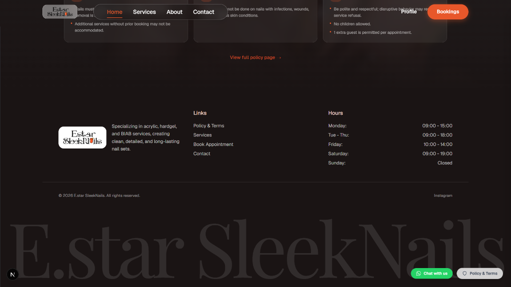
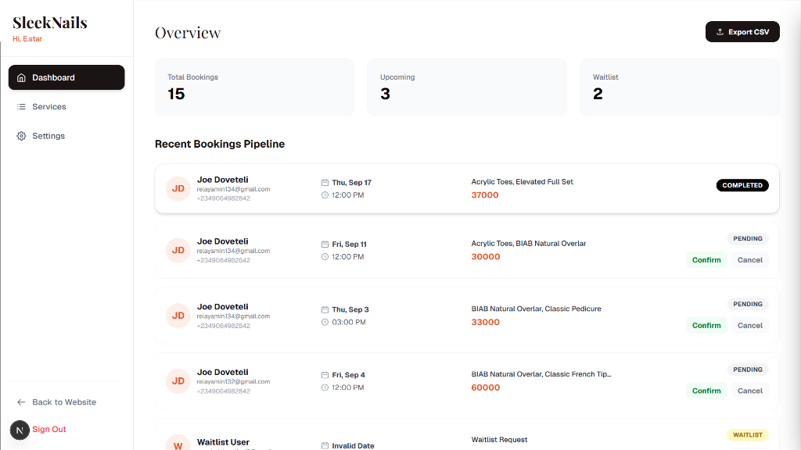
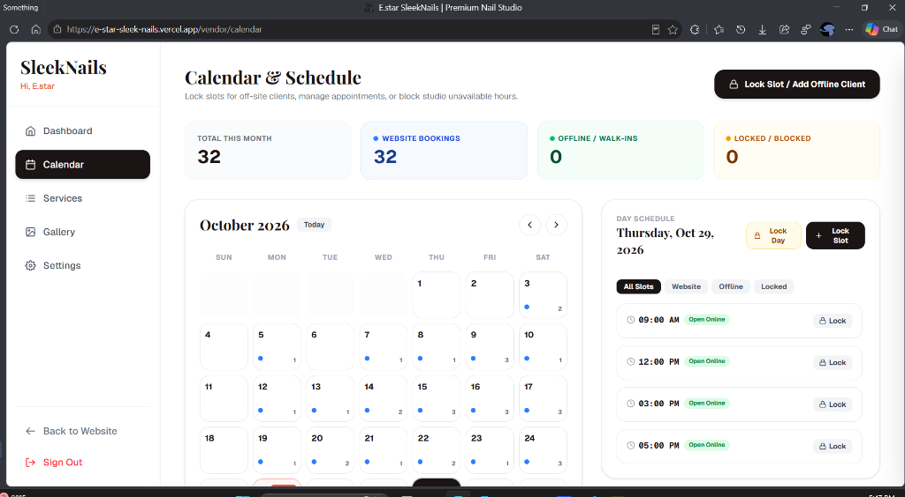
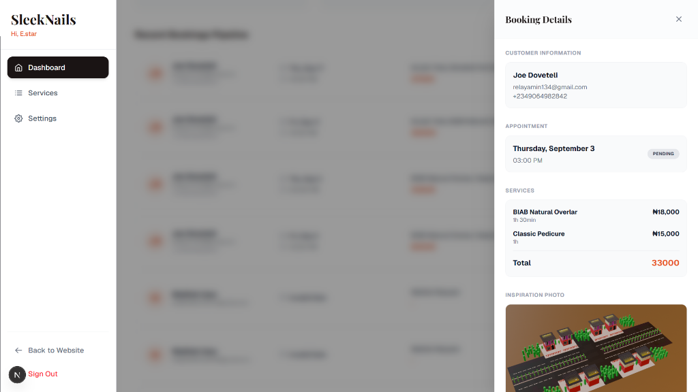

# E.star SleekNails 💅

> **The official luxury booking platform, studio management system, and commerce storefront for E.star SleekNails.** 
> Specializing in flawless, long-lasting acrylic, hardgel, BIAB sets, and bespoke custom nail artistry in Abuja, Nigeria.

[](./TECH-DOCS.md)
[](https://nextjs.org/)
[](https://react.dev/)
[](https://firebase.google.com/)
[](https://tailwindcss.com/)

---

## 📖 Deep-Dive Architecture & Platform Logic

For complete system topology diagrams, mathematical duration heuristics, offline slot conflict algorithms, AI receipt verification prompt chains, and CSV encoding specs, see:
👉 **[TECH-DOCS.md](./TECH-DOCS.md)**

---

## Key Features

- **Studio Calendar & Off-Site Slot Actualization:** An interactive studio calendar view for locking out slots, logging offline/walk-in clients, and blocking studio hours with real-time slot conflict prevention. Synchronizes physical studio operations with web booking inventory.
- **Client Self-Service Dashboard:** Clients can log in, view their bookings, update contact details, upload nail inspiration photos, or paste external design links with optimistic UI updates and backend-enforced edit restrictions post-deposit.
- **Multimodal AI Receipt Verification:** Automated bank transfer receipt analysis powered by Google Gemini Vision (`gemini-3-flash-preview` with automatic fallback to `gemini-3.1-flash-lite-preview`). Verifies transaction completion, recipient (Moniepoint MFB / 7049022919), and deposit amount thresholds.
- **Automated Invoicing & Receipts:** Client-side generation creates printable and downloadable "PAYMENT REQUEST" invoices (for pending bookings) and "OFFICIAL RECEIPTS" (for confirmed, paid bookings).
- **Automated Email & Calendar Dispatch:** Integration with Nodemailer and Google Workspace SMTP (`yemuelinc@gmail.com`) provides branded confirmations, owner notifications, cancellation notices, reschedule alerts, and RFC 5545 iCalendar (`invite.ics`) attachments with 24-hour alarms.
- **Guest-Session Cart Synchronization:** Bookings made by unauthenticated guests are automatically persisted in `localStorage`. If the user later signs up or logs in, their bookings seamlessly attach to their authenticated account.
- **BOM-Encoded Financial CSV Export:** Export complete booking history with UTF-8 Byte-Order Mark (`\uFEFF`) and RFC 4180 escaping to ensure the Nigerian Naira (`₦`) symbol displays cleanly in Excel, Numbers, and Google Sheets without encoding corruption.
- **Role-Based Access Control (RBAC):** Next.js App Router API endpoints are secured using `firebase-admin` and HTTP-only session cookies. Sensitive endpoints like database dumps, booking confirmations, waitlists, and storefront settings are strictly locked to Admin accounts.

---

## Tech Stack

- **Framework:** [Next.js 16 (App Router)](https://nextjs.org/)
- **UI Runtime:** React 19
- **Database & Auth:** Firebase Firestore & Firebase Auth (Client + Firebase Admin SDK)
- **Computer Vision & AI:** Google Gemini Vision API (`gemini-3-flash-preview` / `gemini-3.1-flash-lite-preview`)
- **Styling:** Tailwind CSS v4 (`@tailwindcss/postcss`)
- **Asset Storage:** Vercel Blob (`@vercel/blob`)
- **Transactional Emails:** Nodemailer SMTP (`yemuelinc@gmail.com`)
- **Icons & Micro-UI:** React Icons (`react-icons/fi`) & Sonner Toasts

---

## Getting Started

### 1. Prerequisites
- Node.js 20+
- A configured Firebase project (Firestore + Authentication)
- Google Cloud Gemini API key
- SMTP-enabled email account (with Google App Password)

### 2. Installation
```bash
git clone https://github.com/Relayyl6/E.star-SleekNails.git
cd "E.star-SleekNails"
npm install
```

### 3. Environment Variables
Create a `.env.local` file in the root directory:
```env
# Firebase Client SDK
NEXT_PUBLIC_FIREBASE_API_KEY="..."
NEXT_PUBLIC_FIREBASE_AUTH_DOMAIN="..."
NEXT_PUBLIC_FIREBASE_PROJECT_ID="..."
NEXT_PUBLIC_FIREBASE_STORAGE_BUCKET="..."
NEXT_PUBLIC_FIREBASE_MESSAGING_SENDER_ID="..."
NEXT_PUBLIC_FIREBASE_APP_ID="..."

# Firebase Admin SDK (Server)
FIREBASE_PROJECT_ID="..."
FIREBASE_CLIENT_EMAIL="..."
FIREBASE_PRIVATE_KEY="..."

# Google Gemini Vision
GEMINI_API_KEY="..."

# Email / SMTP
SMTP_EMAIL="yemuelinc@gmail.com"
SMTP_PASSWORD="..."
ADMIN_EMAILS="peteratambaesther@gmail.com,oseghaleleonard39@gmail.com"
```

### 4. Running the Development Server
```bash
npm run dev
```
Open [http://localhost:3000](http://localhost:3000) with your browser to preview the storefront.

---

## Showcase

Here is a glimpse of the E.star SleekNails platform in action:

### Storefront Gallery


### Studio Policies


### Footer & Navigation


### Admin Dashboard


### Studio Calendar & Schedule Management


### Booking Details Management

