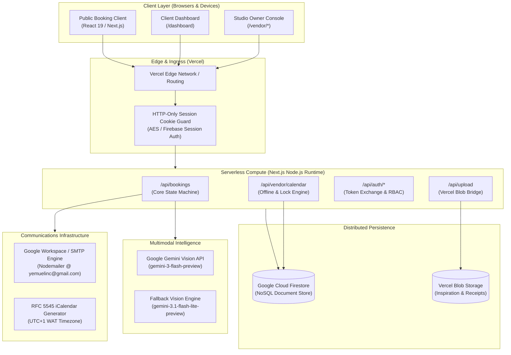
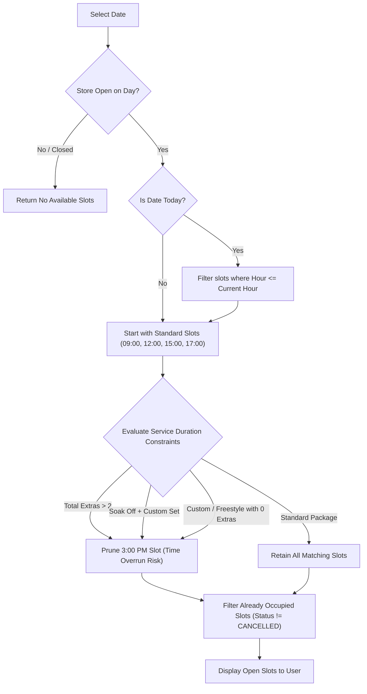
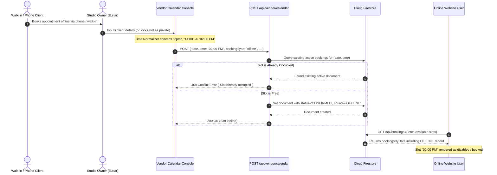
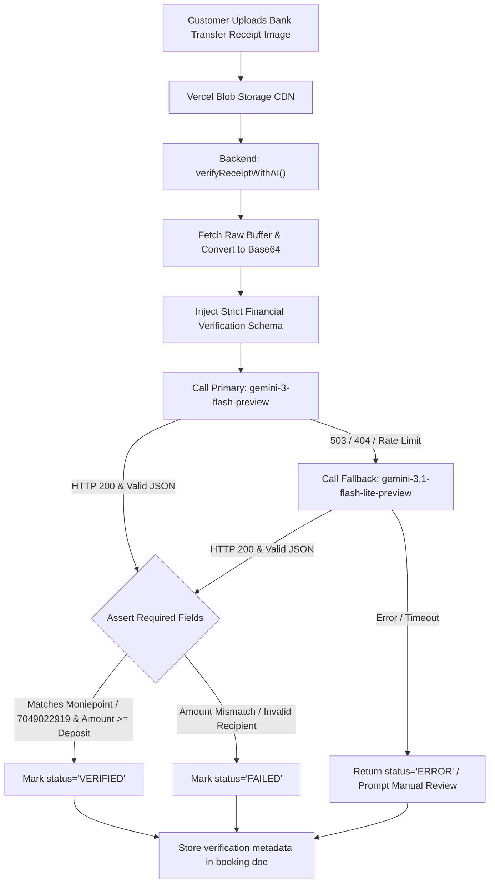
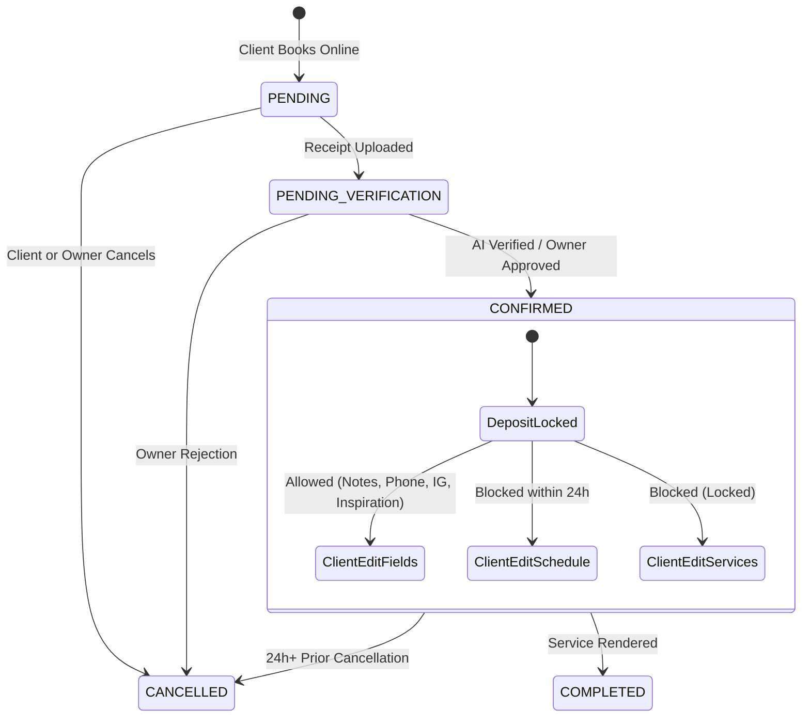
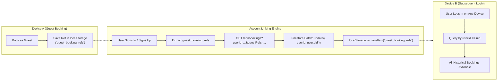
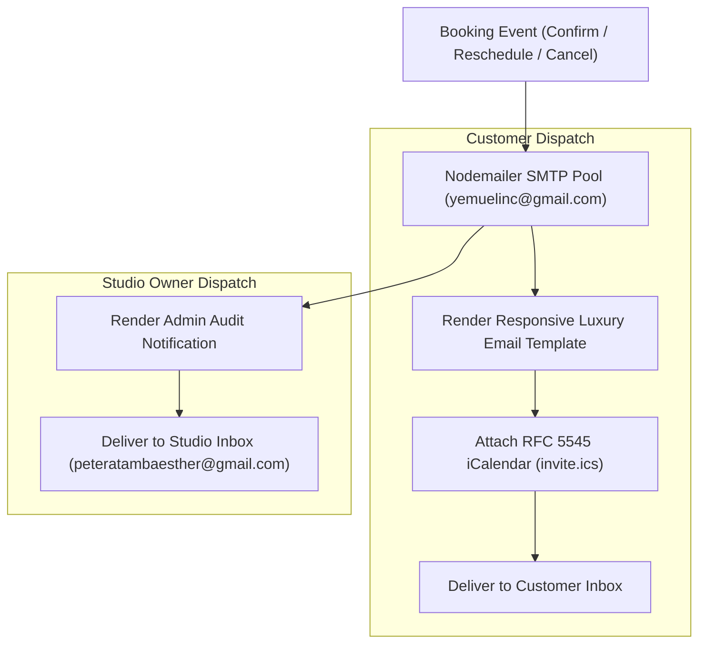

# E.star SleekNails — Technical Documentation & Architecture Reference

> Comprehensive architectural manual, algorithmic reference, and platform logic specification for the **E.star SleekNails** studio management, booking, and commerce engine.

---

## 1. High-Level Architectural Topology



---

## 2. Complete Technology Stack

### 2.1 Core Runtime & Frameworks
| Layer | Technology | Specification / Version | Role in Architecture |
| :--- | :--- | :--- | :--- |
| **Meta-Framework** | Next.js | `16.3.3` (App Router) | Hybrid Server-Side Rendering (SSR), Server Actions, Node.js API Routes |
| **Frontend Engine** | React & React DOM | `19.2.8` | Component rendering, concurrent UI scheduling, optimistic updates |
| **Language** | TypeScript | `^5.0.0` | Strict static typing, schema modeling, build-time type verification |
| **CSS Engine** | Tailwind CSS | `v4.0` (`@tailwindcss/postcss`) | Modern design tokens, responsive layouts, luxury aesthetic styling |
| **Iconography & Toasts**| React Icons & Sonner | `react-icons ^5.7.0`, `sonner ^2.0.8` | Feather icons and accessible stacked toast alerts |

### 2.2 Cloud Persistence, Storage & Authentication
| System | Provider / Tool | Implementation Specifics |
| :--- | :--- | :--- |
| **Database** | Firebase Firestore (Google Cloud) | Real-time NoSQL document store with compound indexes on `userId`, `email`, `date`, and `time`. |
| **Authentication** | Firebase Auth + Firebase Admin SDK | Client-side JWTs with native IndexedDB persistence across devices; backend session cookie exchange (5-day lifespan). |
| **Object Storage** | Vercel Blob (`@vercel/blob ^2.8.0`) | Edge CDN file uploads for nail inspiration photos, bank payment receipts, and gallery artwork. |

### 2.3 Artificial Intelligence & Computer Vision
| System | Model ID / Fallback | Objective |
| :--- | :--- | :--- |
| **Primary Vision Engine** | `gemini-3-flash-preview` | Multimodal OCR and visual transaction auditing of Nigerian bank transfer receipts. |
| **Resilience Fallback** | `gemini-3.1-flash-lite-preview` | Secondary low-latency vision model invoked automatically upon primary API throttling or 503 errors. |

### 2.4 Messaging & Calendar Protocols
| System | Library / Standard | Configuration |
| :--- | :--- | :--- |
| **SMTP Delivery** | Nodemailer (`^10.0.13`) | Environment-configured SMTP pool (`yemuelinc@gmail.com`) for notifications, receipts, and reschedule alerts. |
| **Calendar Sync** | RFC 5545 iCalendar Protocol | Programmatic `.ics` MIME attachment with RFC 2445 Valarm triggers (-PT24H) calibrated to West Africa Time (UTC+1). |

---

## 3. Core Algorithms & Platform Logic

### 3.1 Dynamic Slot Availability & Duration Heuristics (`generateSlotsForDate`)

Public clients cannot book arbitrary hours. Available appointment slots are computed dynamically based on the day's operating hours, current time, and a multi-factor duration heuristic.



#### Mathematical & Logical Constraints:
1. **Operating Hours Gating**:
   $$\text{ValidHours} = \{ h \in \{9, 12, 15, 17\} \mid h \ge \text{openH} \land (h < \text{closeH} \lor \text{closeH} \le \text{openH}) \}$$
2. **Real-Time Date Filtering**:
   If $\text{date} = \text{today}$, prune any $h \le \text{currentHour}$.
3. **The 3:00 PM Collision Pruning Rule**:
   A 3:00 PM (hour 15) appointment risks overrunning into the 5:00 PM slot if the procedure duration exceeds 120 minutes. Therefore:
   $$\text{Hide3PM} = \begin{cases}
   \text{true} & \text{if } \sum \text{extras} > 2 \\
   \text{true} & \text{if } \text{hasSoakOff} \land \text{hasCustomSet} \\
   \text{true} & \text{if } (\text{isCustom} \lor \text{isFreestyle}) \land \sum \text{extras} = 0 \\
   \text{false} & \text{otherwise}
   \end{cases}$$

---

### 3.2 Offline Synchronization & Slot Actualization (Off-Site Bookings)

The platform unifies **in-studio physical operations** (walk-ins, phone appointments, Instagram DM bookings, studio maintenance) with **public web inventory**.



#### Time Normalization Algorithm:
Off-site clients and vendor staff frequently input unstructured time formats. The platform runs a deterministic normalization regular expression:

```regex
^(\d{1,2})(?::(\d{2}))?\s*(am|pm)?$
```
*(case-insensitive evaluation)*

- If meridian ($\text{AM}/\text{PM}$) is omitted:
  - Hours $1 \le h \le 8 \implies \text{PM}$ (e.g. `2` becomes `02:00 PM`).
  - Hours $9 \le h \le 11 \implies \text{AM}$ (e.g. `10` becomes `10:00 AM`).
  - Hour $12 \implies \text{PM}$.
  - Hours $13 \le h \le 23 \implies h = h - 12, \text{PM}$ (e.g. `16:30` becomes `04:30 PM`).
- Zero-pads hour and minute strings into standard `HH:MM AM/PM` to ensure exact string matching across database indices.

---

### 3.3 Multimodal AI Deposit Receipt Verification Engine

To prevent fraudulent reservations without creating administrative bottlenecks, incoming bank transfer receipts are analyzed by multimodal vision models.



#### Verification Criteria Enforced by Model:
1. **Transaction Finality**: Verifies conclusive terms (`"Successful"`, `"Completed"`, `"Paid"`) and rejects pending or failed transfers.
2. **Threshold Verification**: Compares extracted numeral `detectedAmount` against the required minimum deposit ($\text{detectedAmount} \ge \text{requiredDeposit}$).
3. **Beneficiary Identification**: Regex and semantic matching for `E.star`, `Esther`, `Sleeknails`, or studio Moniepoint MFB account number `7049022919`.
4. **Structured JSON Output Guarantee**: Strips Markdown wrappers (`` ```json ``) and parses explicit schema fields:
   $$\{ \mathtt{verified}, \mathtt{status}, \mathtt{reason}, \mathtt{detectedAmount}, \mathtt{detectedBank}, \mathtt{detectedRecipient}, \mathtt{transactionRef} \}$$

---

### 3.4 CSV Export Sanitization & Byte-Order Mark (BOM) Injection

#### The Problem:
When booking history containing Nigerian Naira symbols ($\mathtt{₦}$) is exported as standard UTF-8 text, Microsoft Excel on Windows defaults to local ANSI/Windows-1252 codepages, rendering the symbol as garbled characters (e.g., `₦`).

#### The Architectural Solution:
1. **Byte-Order Mark Injection**: The export engine prepends the 3-byte UTF-8 BOM sequence (`\uFEFF` $\rightarrow \mathtt{EF\ BB\ BF}$) to the head of the file stream. This signals Windows Excel, Apple Numbers, and Google Sheets to parse the file strictly as UTF-8.
2. **Columnar Separation**: Separates currency symbols and numeric values:
   - `Currency`: Always static `"NGN"`.
   - `Amount`: Clean integer derived via `parseInt(String(total).replace(/\D/g, ''), 10)`.
   - `Total Price`: Human-readable display string (`₦25,000+`).
3. **RFC 4180 Escaping**: Every string cell is sanitized:
   $$\text{escapeCsv}(v) = \mathtt{"} + \text{String}(v).\text{replace}(/\mathtt{"}/g, \mathtt{""}) + \mathtt{"}$$

---

### 3.5 Client Self-Service State Machine & Audit History

Clients can access their appointments through `/dashboard` without allowing privilege escalation or schedule collisions.



#### Backend Policy Enforcement (`PATCH /api/bookings`):
- **Service Immutability**: If `!isAdmin`, mutations to `items` or `total` are rejected with `403 Forbidden`.
- **24-Hour Rescheduling Lock**:
  $$\text{HoursNotice} = \frac{\text{BookingTimestamp} - \text{CurrentTimestamp}}{1000 \times 60 \times 60}$$
  If $\text{isDepositPaid} \land \text{HoursNotice} < 24$, rescheduling is rejected with `400 Bad Request`.
- **Immutable Audit Ledger**: Every mutation appends an entry to the `editHistory[]` array:
  ```typescript
  {
    timestamp: "2026-11-09T13:30:00.000Z",
    editedBy: "client@example.com",
    role: "CLIENT" | "ADMIN",
    changes: {
      phone: { from: "+2348011111111", to: "+2348022222222" },
      inspirationLink: { from: null, to: "https://pinterest.com/pin/123" }
    }
  }
  ```

---

## 4. Cross-Device Authentication & Local Storage Synchronization



1. **Unauthenticated Bookings**: Stored with a cryptographic tracking reference (`ref`, e.g. `SLK-849201`) and registered in the device's browser `localStorage`.
2. **Auto-Link Transition**: Upon subsequent user registration or login, the client transmits both `userId` and `guestRefs`.
3. **Permanent Association**: The backend locates all documents matching the user's verified email or guest references, updates `userId = decodedToken.uid`, and deletes the temporary keys from `localStorage`.

---

## 5. Security & Isolation Model

| Threat / Risk | Architectural Mitigation | Code Location |
| :--- | :--- | :--- |
| **Cross-Tenant Booking Snooping** | Non-admin requests to `GET /api/bookings?type=full` are blocked unless `userId === decodedToken.uid` or `email === decodedToken.email`. | `src/app/api/bookings/route.ts#L25-L35` |
| **Unauthorized Reschedule / Collision** | Two-phase occupancy validation tests date/time conflicts against active bookings prior to writing changes. | `src/app/api/bookings/route.ts#L838-L850` |
| **Credential Exfiltration** | SMTP credentials and Firebase service account keys are read strictly from server runtime environment variables (`process.env`), never bundled into client packages. | `src/lib/email.ts#L10-L25` |
| **Session Hijacking** | Firebase tokens exchanged for encrypted HTTP-Only, SameSite cookies with strict 5-day expiration. | `src/app/api/auth/login/route.ts#L46-L61` |
| **Past-Date Manipulation** | Backend asserts $\text{date} \ge \text{todayStr}$ on all booking and slot lock mutations. | `src/app/api/vendor/calendar/route.ts#L129-L135` |

---

## 6. Communication & Calendar Infrastructure

When an appointment is approved, rescheduled, or cancelled, the communication pipeline executes a dual-dispatch event:



### RFC 5545 iCalendar Payload Structure:
- **Timezone Adjustment**: Converts appointment times from local Nigerian time (UTC+1 WAT) to ISO 8601 UTC Zulu (`formatICSDate`).
- **Dynamic Duration**: Calculates appointment length dynamically from selected services (`item.duration` in hours and minutes; defaults to 120 minutes).
- **Proactive Alarms**: Embeds `BEGIN:VALARM` with `-PT24H` trigger for 24-hour native push reminders in Apple Calendar, Google Calendar, and Outlook.

---

## 7. File & Module Reference Index

- [`src/app/api/bookings/route.ts`](file:///c:/Users/USER/Documents/client/Sleek%20naisl/src/app/api/bookings/route.ts): Core booking engine, AI verification, slot conflict checking, customer/admin notifications, and audit logging.
- [`src/app/vendor/calendar/page.tsx`](file:///c:/Users/USER/Documents/client/Sleek%20naisl/src/app/vendor/calendar/page.tsx): Studio owner interactive calendar, slot locking interface, and offline booking actualization.
- [`src/app/api/vendor/calendar/route.ts`](file:///c:/Users/USER/Documents/client/Sleek%20naisl/src/app/api/vendor/calendar/route.ts): Backend endpoints for offline slot locking, multi-slot batch creation, and conflict detection.
- [`src/app/dashboard/page.tsx`](file:///c:/Users/USER/Documents/client/Sleek%20naisl/src/app/dashboard/page.tsx): Customer self-service dashboard with inline booking editing, photo upload, and invoice generation.
- [`src/app/vendor/dashboard/page.tsx`](file:///c:/Users/USER/Documents/client/Sleek%20naisl/src/app/vendor/dashboard/page.tsx): Studio management console, AI receipt review card, and BOM-encoded CSV export.
- [`src/lib/email.ts`](file:///c:/Users/USER/Documents/client/Sleek%20naisl/src/lib/email.ts): SMTP connection management and transactional email delivery engine.
